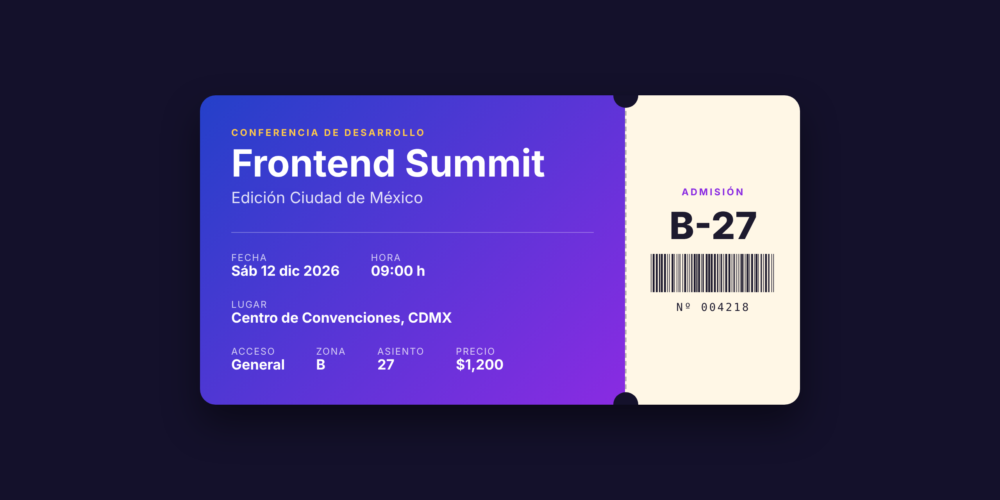
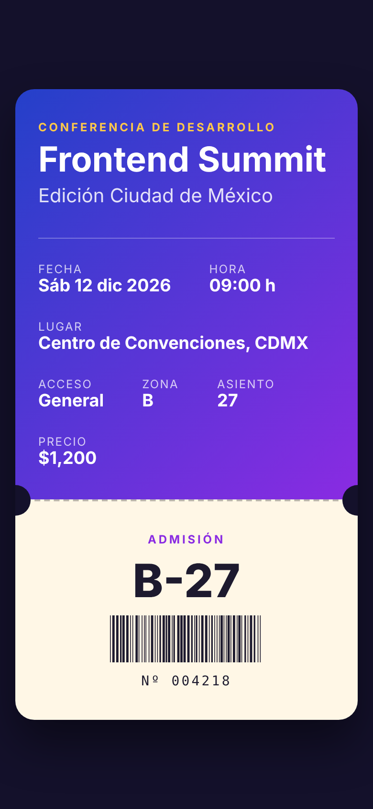

# Diagnóstico: boleto de conferencia

## Qué hay que hacer

Maqueta con HTML y CSS el boleto de la conferencia del diseño de referencia, en sus dos versiones: horizontal en escritorio y vertical en celular. Sin JavaScript ni librerías.

El resultado debe acercarse lo más posible al diseño en los dos tamaños. Abajo encontrarás las imágenes, colores, medidas, tipografía y espaciados necesarios.

**Material:** en la carpeta [`assets`](assets/) están `barcode.svg` (código de barras), `ticket-desktop.png` y `ticket-mobile.png` (diseño a tamaño completo, al doble de resolución).

## Contenido

**Cuerpo del boleto**

- Etiqueta: Conferencia de desarrollo
- Título: Frontend Summit
- Subtítulo: Edición Ciudad de México
- Datos del evento: Fecha, sábado 12 de diciembre de 2026 (se muestra como Sáb 12 dic 2026) · Hora, 09:00 h · Lugar, Centro de Convenciones, CDMX
- Datos del acceso: Acceso, General · Zona, B · Asiento, 27 · Precio, $1,200

**Talón**

- Etiqueta: Admisión
- Lugar: B-27
- Código de barras (`assets/barcode.svg`)
- Folio: Nº 004218

## Diseño de referencia

En escritorio, el boleto es horizontal: el cuerpo a la izquierda y el talón a la derecha, separados por una línea punteada con un recorte semicircular arriba y abajo, como un troquel. En celular (menos de 640 px de ancho) el talón pasa abajo, la línea punteada se vuelve horizontal y los recortes quedan a los lados.

### Escritorio

### Celular

### Colores

| Elemento | Color |
| --- | --- |
| Fondo de la página | `#14112b` |
| Fondo del cuerpo | Degradado a 135° de `#2440c9` a `#8a2be2` |
| Etiqueta del cuerpo (Conferencia de desarrollo) | `#ffc94a` |
| Título (Frontend Summit) | `#ffffff` |
| Subtítulo (Edición Ciudad de México) | `#ffffff` con opacidad 0.85 |
| Nombres de los datos (Fecha, Hora, Lugar, Acceso, Zona, Asiento, Precio) | `#ffffff` con opacidad 0.75 |
| Valores de los datos (Sáb 12 dic 2026, General, $1,200…) | `#ffffff` |
| Línea sobre los datos del evento | `#ffffff` al 30 % |
| Fondo del talón | `#fff7e6` |
| Etiqueta del talón (Admisión) | `#8a2be2` |
| Asiento del talón (B-27) y folio | `#1d1a2e` |
| Línea punteada entre cuerpo y talón | `#1d1a2e` al 30 % |
| Sombra del boleto | `#000000` al 45 % |

### Medidas

| Elemento | Medida |
| --- | --- |
| Ancho máximo del boleto | 768 px (48 rem) |
| Ancho del talón en escritorio | 224 px (14 rem) |
| Radio de las esquinas | 20 px (1.25 rem) |
| Diámetro de los recortes | 32 px (2 rem) |

### Tipografía

Fuente del sistema: `system-ui, -apple-system, "Segoe UI", Roboto, Arial, sans-serif`.

| Elemento | Tamaño | Estilo |
| --- | --- | --- |
| Etiquetas (Conferencia de desarrollo, Admisión) | 0.75 rem | Negritas, mayúsculas, espaciado entre letras 0.2 em |
| Título | 3 rem (2.25 rem en celular) | Negritas, interlineado 1 |
| Subtítulo | 1.25 rem | Normal |
| Nombre del dato (Fecha, Zona…) | 0.75 rem | Normal, mayúsculas, espaciado entre letras 0.1 em |
| Valor del dato | 1.125 rem | Negritas |
| Asiento del talón (B-27) | 3 rem | Peso 800, interlineado 1 |
| Folio | 0.875 rem | Monoespaciada, espaciado entre letras 0.15 em |

### Espaciado y detalles

| Elemento | Valor |
| --- | --- |
| Relleno de la página | 2 rem arriba y abajo, 1 rem a los lados |
| Relleno del cuerpo | 2.5 rem (en celular: 2 rem arriba y abajo, 1.5 rem a los lados) |
| Relleno del talón | 2 rem arriba y abajo, 1.5 rem a los lados |
| Separación entre elementos del talón | 0.75 rem |
| Margen sobre título y subtítulo | 0.5 rem |
| Línea sobre los datos del evento | 1 px sólida, blanco al 30 %, con 2 rem de margen arriba y 1.5 rem de relleno debajo |
| Margen sobre los datos del asiento | 1.5 rem |
| Separación entre datos | 1.5 rem vertical, 2.5 rem horizontal |
| Línea punteada entre cuerpo y talón | 2 px, color `#1d1a2e` al 30 % |
| Ángulo del degradado | 135° |
| Sombra del boleto | 0 desplazamiento horizontal, 1.5 rem vertical, 3 rem de difuminado, negro al 45 % |
| Ancho máximo del código de barras | 10 rem |
| Color de la etiqueta Admisión | `#8a2be2` |

## Requisitos

### HTML

- Documento completo: idioma, codificación, `viewport` y título.
- Etiquetas semánticas: el boleto es una unidad de contenido independiente y el talón es contenido complementario. Usa `div` solo cuando no exista una etiqueta con significado.
- Un solo `h1`.
- Los pares dato y valor (Fecha: Sáb 12 dic 2026, Zona: B, etc.) se marcan con la estructura de HTML pensada para eso.
- La fecha y la hora usan la etiqueta adecuada con su valor legible por máquina.
- El código de barras tiene un texto alternativo descriptivo.

### CSS

- Un archivo `styles.css` aparte, con los colores y medidas principales definidos como variables.
- El boleto queda centrado en la página, horizontal y verticalmente.
- La división entre cuerpo y talón se hace con Grid.
- Los datos del evento y del asiento se acomodan en fila y se reacomodan solos si no caben.
- El contenido del talón queda centrado.
- Los recortes del troquel se hacen con pseudo-elementos, sin agregar elementos al HTML.
- En celular el boleto se vuelve vertical con una media query.
- Usa unidades relativas (`rem`, `%`) y selectores de clase. No uses `!important`.
- Nombra clases, variables y archivos en inglés; el contenido visible va en español.

## Reglas y entrega

- **Tecnología:** solo HTML y CSS. Sin frameworks (Bootstrap, Tailwind) ni JavaScript.
- **Puedes consultar** documentación (MDN) y buscadores. No uses herramientas de IA.
- **Entrega:** `index.html` y `styles.css` en esta carpeta. Usa el código de barras desde `assets/barcode.svg`.
- En la revisión presentarás tu solución en escritorio y en celular: cómo la resolviste y, si algo no lo lograste, por qué y hasta qué punto llegaste. Si no terminas, entrega hasta donde llegaste.
